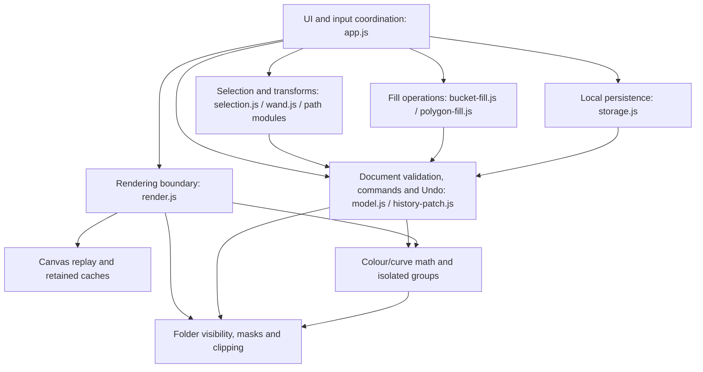
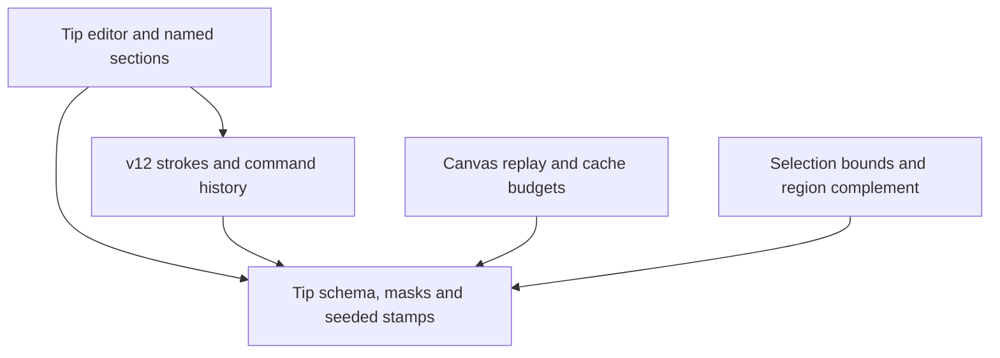
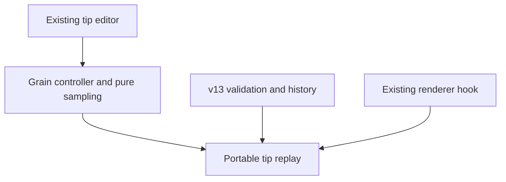
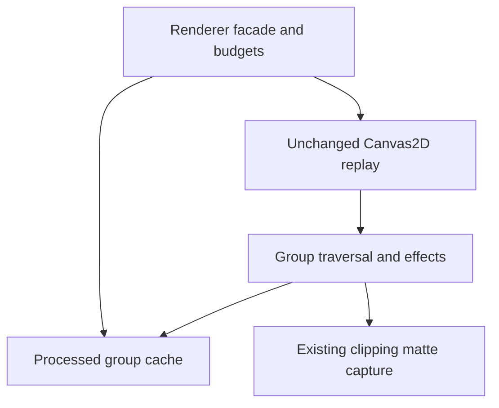
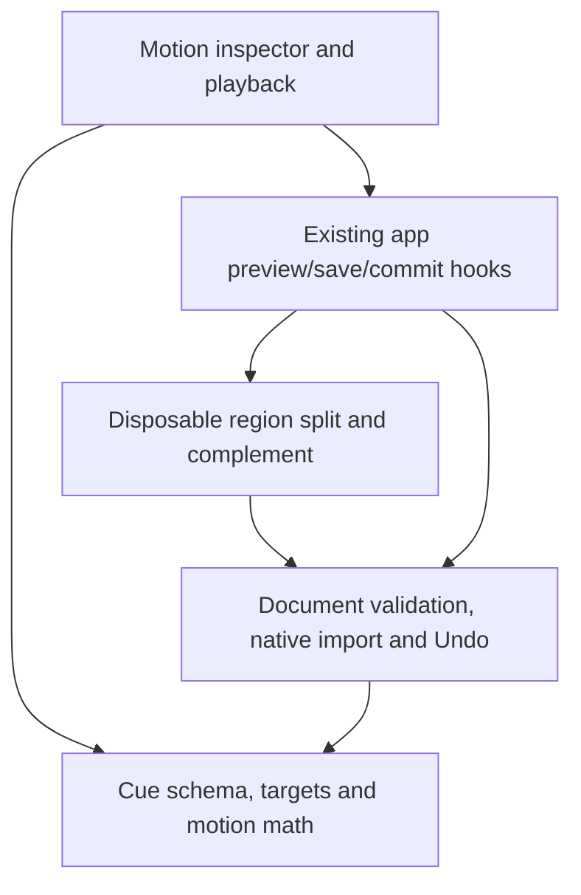
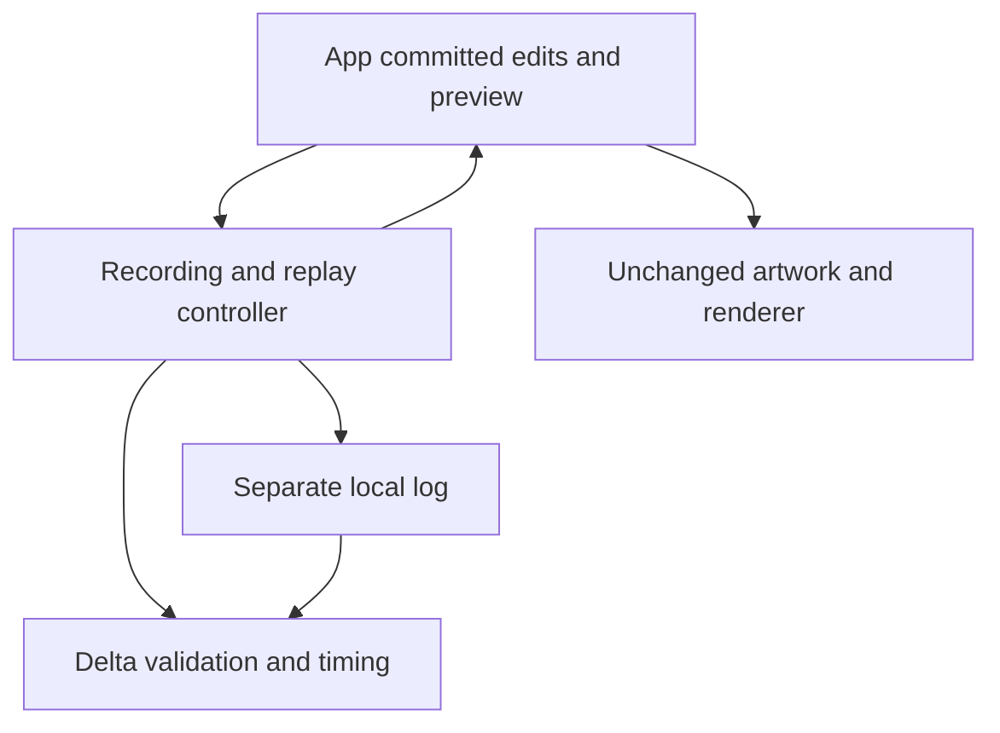
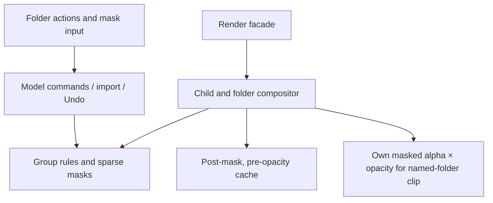
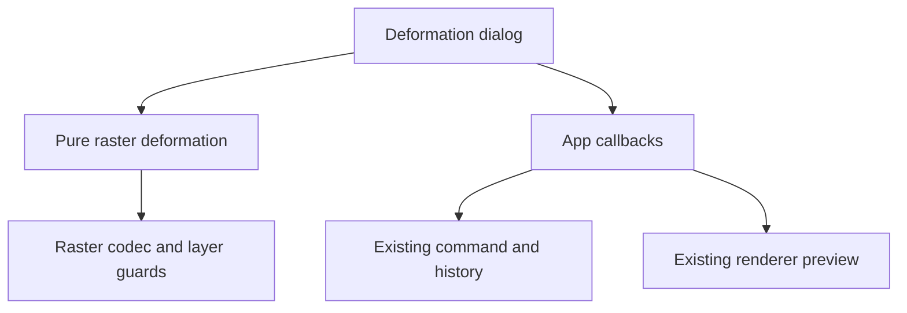

## CHAIN1 persistent-project and UI integration candidate
`virtual-project-store.js` adds project metadata in existing IndexedDB meta, using one boards/meta transaction for atomic project/source saves, revision CAS, preserved native previous records and full-project backup/import. It validates through model plus source-scene; no native schema/storage.js changes. `virtual-project-ui.js` owns project lifecycle, save-before-switch, group headings, per-source session Undo/shared history budget, backup controls and gallery entries. Narrow app hooks project source-board previews into the existing renderer on the same canvas and clear transient selection/mask state on activation. Mask target IDs are mapped into the disposable scene; scene revision tracks source revision changes for cache invalidation. Standalone app paths preserve original native semantics. sw.js caches all five project/contract modules; cache assertions advance identity only. Current limits/unsupported cases remain in CURRENT_CHECKPOINT. Logical responsibility map; not an AST proof or independent review.

## CHAIN1-C unverified integration candidate — 17-Oct-2026
`virtual-group-scene.js` imports existing model validation and folder hierarchy plus the CHAIN1 manifest validator. It constructs a detached budget-validated rendering projection with namespaced local identities and delegates to caller-injected existing renderer. Native sources and per-source history remain authoritative. Full source replay preserves backdrop-dependent blends; no flattened proxy equivalence claimed. No app/UI/storage/schema/renderer changes. New model and Chromium oracle/storage-recovery tests are invoked by cumulative CI. Project UI/persistence/offline integration remains OPEN; see current checkpoint for execution status.

# UNRULY — code structure and change boundaries
Current TIP4 published and hosted verified: `597b6fa72114c38141c64486d393f5de3ee737cd`, CI38952135785SUCCESS499models/412structuredChromium+2legacy;177source hashes verified. Remaining product/capacity/device acceptance stays OPEN.
This is a logical module map derived from actual source/import reads, not an AST call graph or proof of runtime independence. Update after any build changing module responsibilities, dependencies or document/render contracts.

## Current logical blocks

Arrows mean principal imports/calls across logical blocks; omitted utility imports are not evidence of isolation. This is browser-native module code, not separate services.

| Responsibility | Actual files under prototypes/browser-workspace | Boundary / regression obligation |
| --- | --- | --- |
| UI/input orchestration | app.js, index.html, style.css; gestures.js, pen-input.js, pressure-ui.js, path-selection-ui.js | Events, draft state, tool arbitration and orchestration; UI remains a shared dependency. Add targeted interaction tests plus cumulative journeys. |
| Document authority / history | model.js, history-patch.js | Validation, capacity, commands, version/import remapping, exact Undo/Redo. Model imports feature validators/mutators; feature modules sometimes import model commands, so strict acyclic layering is NOT established. |
| Selection / geometry | selection.js, wand.js, lasso-region.js, path-selection.js, magnetic-selection.js, shapes.js | Distinguish editable artwork versus selection-outline geometry. Pixel edits preserve original artwork through one undoable conversion; no silent whole-object fallback. |
| Fill | bucket-fill.js, polygon-fill.js | Gap traversal and geometric fill reuse bounded raster/selection operations; do not change selection or renderer semantics to obtain green tests. |
| Brush / raster work | brushes.js, brush-recipe.js, raster.js, raster-tiles.js, pixel-paint.js, pixel-surface.js, smudge.js | Pressure/tip replay and bounded pixels; presets and native pixels are distinct. Preserve deterministic replay and codec/capacity contracts. |
| Composition | folders.js, group-composition.js, masks.js, clipping.js | Optionalv16 folder opacity/blend pair and document-space masks; legacy pass-through retained. Effects/enabled masks/explicit controls isolate. Combined effects → mask → opacity once → blend; named-folder matte includes own mask/opacity. Group mutations guard ancestry/locked descendants; ungroup refuses appearance loss. |
| Renderer boundary | render.js, render-contract.js | Chooses replay/reference behavior, composition/cache hooks and diagnostics. No document-storage writes here. |
| Renderer implementation/cache | canvas2d-renderer.js, layer-compositor.js, raster-cache.js | Original replay oracle, retained live rendering, backing/cache budgets and invalidation. Changed pixels require reference comparisons. |
| Colour adjustments | adjustments.js, adjustment-ui.js, effect-compositor.js | Pure HSL/levels validation/math without model imports; separate modal controller; isolated combined-group replay. model validates v10 and wraps commands; render applies leaf colour before masks/clip and group colour after children. Group isolation uses padded full-frame surfaces; CAP2 adds optional bounded processed-folder retention at the facade/compositor boundary. Budget includes retained bytes and temporary depth; no target-device performance claim. |
| Curves / Gaussian blur | filters.js, filter-ui.js; narrow model/render/effect-compositor hooks | v11metadata; pure curve LUT and bounded premultiplied Gaussian reference/fallback; native checked Canvas2D blur, full padded replay. Curves then blur after HSL, before leaf masks/clipping. Padding includes maximum nested blur-branch support; enlarged offscreen buffers and group depth fit80MiB backing. Clipping cache now has bounded processed-folder matte capture for blur alpha. Original snapshots unchanged. |
| Text/import | text.js, image-import.js, image-clipboard.js | Input limits, text/raster representation, reference separation and clipboard portability. |
| Persistence/offline delivery | storage.js, sw.js | storage validates through model; revision/conflict/save guards. sw asset list/cache revision must include every new runtime module. Offline smoke required. |

## Honest current limitations
- app.js is 429 physical lines with dense event/UI/operation wiring: a shared coordinator, not a cleanly separated controller per feature.
- model.js centralizes validators/commands and imports feature modules. This map does not prove absence of cycles or low coupling.
- Per-change impact.yaml and plan.yaml have allowed/prohibited paths and regression links, e.g. FILL2. The inspected cumulative workflow runs regression/source hashes; it does NOT consume/enforce those path lists.
- CI successes demonstrate tested scenarios, not perfect scope, clean architecture, target-device performance or independent human approval.
- No unsolicited broad refactor is authorized by this document. A restructuring must have its own bounded scope, behavior-preserving tests and explicit rationale.

## Evidence required for each future code change
1. Pin base/source commit and roadmap row/requirement; list acceptance criteria and exclusions.
2. Trace affected modules and direct callers/importers; record effects on saved format, history, composition, cache/offline assets. Distinguish observed dependencies from guesses.
3. Commit a bounded impact and plan with exact allowed files, prohibited areas and linked tests BEFORE implementing.
4. Review actual diff against that list. Report any unplanned file and revise scope before proceeding. Do not describe this manual check as CI enforcement.
5. Preserve old assertions. Execute targeted positive/negative/cancel/Undo/persistence tests and cumulative QA; renderer changes also compare reference output and budgets.
6. Publish only the verified source; report source commit, CI result, merge/deployment identity and hosted-source comparison.
7. Update PRODUCT_ROADMAP, CURRENT_CHECKPOINT and CONTINUATION_CONTRACT with status/evidence. Update this map only if dependencies/contracts changed. Keep pending scope intact.

## HSL1 implemented localization — verified and published
New adjustments.js (pure math/validation/mutation), adjustment-ui.js (unsaved preview/Apply/Cancel), effect-compositor.js (combined adjusted-folder replay). model.js imports adjustment validation and exposes one command. render.js invokes leaf adjustments, tracks group depth and wires group replay; canvas2d-renderer.js has optional group/depth hooks, preserving default legacy source through exact hook normalization and the unchanged frozen hash. No storage/selection/fill/brush changes. Scope/diff and exact source evidence in .delivery/CHG-UNRULY-HSL1-1013. Cumulative QA passed307models/289Chromium; actual physical-device acceptance remains unverified.

## Durable references
- PRODUCT_ROADMAP.md: full scope, not merely next painting builds.
- CURRENT_CHECKPOINT.md and CONTINUATION_CONTRACT.md: latest build identity and constraints.
- .delivery/CHG-UNRULY-FILL2-1013/impact.yaml and plan.yaml: example scoped change.
- .github/workflows/browser-workspace.yml: actual cumulative QA.
- tests/browser-workspace/: model/browser/reference/capacity regressions.

## FX2 localization — verified/published
filters.js owns strict schema/math/mutation without a model import; filter-ui.js owns graph/channel/numeric/blur draft and injected preview/commit callbacks. model.js validatesv11/exposes one filter command. render.js computes halo branch support and wires filters/group matte capture. canvas2d-renderer.js changes only exact declared geometry/padded replay hooks, preserving frozen unfiltered source and pixels. effect-compositor.js reuses isolation/temporary surfaces for curves/blur. clipping.js captures filtered group alpha within existing8MiB cache; no silent alpha-union substitute. app.js has narrow entries/draft hooks; no broad controller rewrite. Existing source, schema/history, and render dependencies are shared hubs, not independent services. All other roadmap scope retained; KG unchanged.

FX2 verification322models/299Chromium/132identity matches; publication50hosted byte matches. Native Gaussian approximation and physical-device/50-layer limits recorded in scoped QA. Existing unfiltered renderer frozen source/pixel oracles retained. This remains a logical import/responsibility map,not an executed AST/runtime graph or proof of independently enforced CI path scope.

## TIP1 implementation — verified and published
custom-tips.js owns strict mask/options/library validation, bounded image conversion, seeded distance traversal, pressure mapping and isolated draw helper. custom-tips-ui.js owns disposable import/edit previews, atomic local-library writes and named section/preset management. app.js wires only selection/pressure identity, gesture seed, shape-hold exclusion and target guards. u2.js separates image-tip selection from built-in memories. model.js admits portable v12 strokes and rejects replay overflow before committing. selection.js preserves tip scale/rotation and includes scatter in bounds/clipboard. lasso-region.js uses the same radius for complete complement tile enumeration; renderer thumbnails/smudge snapshots receive an optional radius hook. image-import.js preserves newer document versions. render.js injects optional tip replay/radius and reserves the temporary mask canvas inside the existing80MiB live backing/cache allowance. Legacy raw renderer default source/pixel oracles remain unchanged. No storage/graph/skill rewrite.

This scoped logical dependency map is not an AST/runtime graph. Existing circular feature/model dependencies remain; this build does not establish global acyclicity. Imported tip masks/options/seed live in each drawn stroke, separately from the device library. Newer boards require v12-capable readers; pressure overrides remain device-local, while saved strokes embed effective dynamics. Automatic photo-subject removal/Photos folder ingestion, proprietary brush formats, custom-tip alpha-lock stamping, folder masks and target-device latency remain unverified or pending. TIP2 grain/textures remains a separate open checkpoint.

TIP1release evidence: Sourcea415dd3530bd0ff8cdb7479cd60e22e2d8f0dd33; Actions38583117039 SUCCESS341model tests/310Chromium scenarios/136source identities. PR14 merge95911bae5c52f68757bae658bbd8685d5121b1a2 exact tested tree. Publicationc0cccf354d23914be7b115cedf57b7a2769be948; Pages38585969301 SUCCESS52hosted byte matches.Manual scope match and18byte-unchanged shared modules recorded in scoped SCOPE_REVIEW.json; no CI path-enforcement or global architectural independence claim. All remaining product scope retained; KG unchanged.

## TIP2 + CAP1 batch — published; capacity target still open15-Oct-2026
grain.js owns strict64pxtexture admission, alpha-aware image conversion, deterministic tip-local tiled sampling and procedural Splatter/Sprinkle masks. grain-ui.js owns grain upload/invert/scale/depth/rotation/clear within the existing disposable tip editor; cancel invalidates pending decode. custom-tips.js admits optionalv2grain and passes precomputed alpha into the existing draw hook. model/selection admitv13and preserve oldv1tips/clipboard/history semantics. No raw renderer/storage changes. sw.js adds only new grain modules and cache identity. Capacity tests exercise existing buffers/IDBwithout raising32layer limit.

A logical module map, not a regenerated knowledge graph or executed ASTgraph. Existing shared hubs/cycles remain.20shared modules are byte-unchanged per scoped SCOPE_REVIEW.json. Source3af2a6bdf84dd251c83a7770f26d5cd5fd7f9eba; CI38671904693SUCCESS358models/320Chromium/142source identities. PR15mergeff4b756709da36cff77edab0ed56aeb67e39ff52 exact tested tree. Publicationeeca0961697662996aa2c752db4d9d350dd23f4a; Pages38673569838SUCCESS54hosted byte matches.

CAP1found50layer mixed full replay ~0.5sDPR1/~1.2sDPR2onCI; paired removal of group HSL/blur reduces warm work to~65–180ms. Group effect isolation currently causes full replay, so CAP2should investigate retained processed-group surfaces plus exact invalidation/backing allowances. No unmeasured renderer rewrite or layer-cap increase included.30–50interactive performance and physical device/long-session acceptance remain OPEN. Detailed fixture/results and recovery cases in .delivery/CHG-UNRULY-TIP2CAP-1015/CAPACITY_REPORT.*.

CAP1decision:32layer model/image-import boundary unchanged; no capacity.jsor old assertion migration implemented. The conditional initial scope was superseded by measured Revision2before any cap change. Full capacity/performance work is explicitly carried intoCAP2. KG unchanged.

## CAP2 localization — verified and published, 15-Oct-2026
Base5d5a3afcc04ff94420659b9dce0a8035594542b8; final candidate90630dd21ab35c5b4000ce93bcbeddd98017a8f5. render.js owns lifecycle and80MiBheadroom calculation; group-cache.js owns<=16MiBfull padded surfaces, key lookup, replacement/release and allocation-failure bypass. effect-compositor.js optionally reuses processed folders before existing afterGroup matte capture. Whole-board content serialization conservatively invalidates all groups after committed edits; live content affects containing groups and external clipping-input groups. External consumers of descendant leaf/nested-group mattes prohibit skips that would omit required captures. Geometry/helpers/reference/failure release retained stores. Reference mode never reuses processed surfaces.

Logical responsibility map only; no graph regeneration or global coupling claim. Original canvas2d-renderer/model/storage/clipping/filters/folders and other application modules remain byte-identical. SW adds group-cache.js and cache identity. Six legacy offline test files migrate only exact SWversion literals; no assertions removed. Scoped SCOPE_REVIEW/CONTRACT_CHECK/PERFORMANCE_REPORT/QA_RECEIPT/PUBLICATION_RECEIPT hold source evidence. Mixed fixtures improve but active effect processing and unretained/unadjusted leaf replay remain expensive.32layer cap and real-device/30–50interactive targets remain open.

Source 90630dd21ab35c5b4000ce93bcbeddd98017a8f5; cumulative CI 38729736179 SUCCESS: 361 model tests, 322 Chromium scenarios, 145 source identities verified from the downloaded artifact. PR16 merge 2fff3989c3964bbd6bcdcef11f943b088cb066db has the exact tested tree. Publication commit 6196d39e47b90bae9be279b18c789588cd053141; Pages 38731877005 SUCCESS with 55 hosted application files matching tested bytes.

## MOTION1 localization — verified and published

motion.js owns strict optional v14cue schema,identity remapping,target resolution,path-distance/camera interpolation and disposable translation without model/DOM/storage imports. model.js calls schema/remapping and exposes one motion command; original document budgets remain. motion-region.js alone reuses existing history/region split/complete complement primitives to prepare transient selected pixels. motion-ui.js owns inspector/draft/capture/manual-timed/Pause/Stop/Commit lifecycle. app.js adds narrow target,preview,save and commit callbacks; h.board remains the only autosave/export authority. Original renderer/storage/selection/wand/lasso/history modules are unchanged. SW adds three modules and new worker identity.

This is a logical responsibility/import map,not an executed AST graph or proof of global acyclicity. Existing app/model hubs remain. Same-layer mixed region/object target identities are a known compatibility boundary of the existing whole-layer raster split,retained OPEN rather than bypassed. Future-change surfaces and re-open triggers are in scoped CHANGE_IMPACT_COMPENDIUM.md. No graph regeneration or skill changes.

Source 81a452809df78203b067e9e6a7e02569f1b4c409; cumulative CI 38768769402 SUCCESS: 372 model tests, 332 Chromium scenarios and 150 source hashes verified from the downloaded artifact. PR17 merge f7ae0187bb151bc4283458ac4ecb614743538917 has the exact tested tree. Publication commit 8a558d4ac42201f1a2d93fa69fb337c5511c73c0; Pages 38771750451 SUCCESS, with 58 hosted application files matching tested bytes.

## TIME1 localization — verified and published

timelapse.js owns strict bounded delta/timing/reconstruction and confirmed root-ID backup attachment; native validation is injected, with no model/DOM/storage imports. Retained text fragments own their backing. timelapse-store.js owns separate append-only IndexedDB events/meta/global payload budget, atomic revision guards and tombstones; it never opens artwork storage. timelapse-ui.js owns recording/queue/gap/reload lifecycle,validated backup/import/confirmation/discard and read-only replay.

app.js adds committed-change observation,board-transition flush and disposable preview callbacks. h.board remains the only artwork/autosave/native-export/Undo authority. Original model/history/artwork storage/renderers are unchanged. HTML/CSS preserve existing inspector tokens; SW adds three modules and identity.54existing app files byte-identical;7older offline test edits are exact cache identity strings. Manual scope checks are not CI-enforced path protection.

This is a logical calls/import map,not an executed AST/knowledge graph or global acyclicity proof. Existing app/model hubs remain shared. Recording payload budgets are separate from8MiBboard/16MiBhistory/80MiBrender backing;32layers remain. Recorded state can persist before artwork autosave because transactions are separate. Preview never promotes recorded geometry to live artwork. Paused/reload gaps are marked current states. Video/continuous ink animation/navigation/framing and physical/long-session acceptance remain open. Re-open triggers and future change surfaces: scoped CHANGE_IMPACT_COMPENDIUM.md.

## STAB1 input boundary —16 October2026

`stabilization.js` owns pure constant-state distance filtering of x/y only; `stabilization-ui.js` owns device-local range preference and blocked-state/storage-error feedback. app.js snapshots amount/zoom at vector/pixel/mask admission and passes ordered/coalesced points through the filter, with exact release endpoint. Existing renderer/model/history/storage consume ordinary geometry/pixels; no replay metadata or schema changes. Held-shape recognition, smudge, lasso, navigation and artwork erasing retain existing paths. UI range is separate from portable brush/stroke settings. This remains a bounded logical map, not an AST/call graph.

## GUIDE1 + NODE1 input and geometry boundary
guides.js owns bounded guide projection/snapping and symmetric editable copies. artwork-geometry.js owns strict optional v15 nodes/handles/source witness, sampled replay, current-source detection, metadata transforms and bounded hit testing. drawing-tools-ui.js owns disposable draft/local history and UI-only SVG, injected board/view/commit callbacks. app.js owns input arbitration, source-reference rejection and atomic commit; model.js validates v15; selection.js transforms authoring/witness and upgrades paste. Rendering/history/storage engines unchanged. Erase invalidates source correspondence; subsequent editing visibly uses current points. This is a logical map, not an executed AST/knowledge graph.

## TIP3 alpha-locked image-tip boundary

image-tip-paint.js imports existing custom-tips (deterministic visit/draw including grain), pen dynamics validation and raster encoding. It owns frozen source/settings, conservative work admission, disposable Canvas coverage, exact-alpha RGB composition and cached raster draft. app.js routes existing Vector ink + Alpha lock admission into this adapter through the existing pixel-preview/commit/cancel path. model/history/storage/render engines remain unchanged. Layer metadata stays in its original pipeline; alpha-locked raw artwork becomes pixels only on commit and Undo restores originals. This is a logical module map, not a generated knowledge/AST graph.

## PAL1 colour-library boundary

palettes.js owns pure bounded library validation/migration/immutable commands/append import, linear-light RGB interpolation and reference-coordinate/source-RGB rules. palettes-ui.js owns separate device-local library/backup/ten-snapshot session Undo, Colour inspector controls and disposable reference picker. U2 remains current brush/HSV/recents authority and accepts a colour-change notification for palette rendering. app.js injects board/reference getters and reveal callback, integrates draft blocking/keyboard/sync. No artwork/native/model/history/storage/renderer engine change. This is a logical responsibility map, not an AST or knowledge graph update.

## COMP1 current localization

group-composition.js imports only folder helpers; it owns strict optional v16 pair validation, mutation and read-only guards. model imports it and extends existing mask command/import ID remapping. filters imports isolation policy; effect-compositor invokes the injected post-filter group-mask hook before cache retention, then applies opacity/blend when composing into parent. render injects that hook using existing scratch/decode, and clipping captures own processed group alpha including opacity. app reuses folder menus/Hide-Reveal with child input anchor; switching active layer ends group-mask mode. No broad coordinator refactor or new history/storage/canvas engine. Shared hubs remain shared; no global acyclicity/path-enforced-CI claim.

All earlier checkpoint notes below their dated headings are historical as-built evidence. Existing capacities unchanged. Same-session bounded model/browser/pixel/visual verification does not establish physical-device feel or independently approved architectural isolation. Scoped receipts in .delivery/CHG-UNRULY-COMP1-1016/.

## TIP4 current localization

guides.js owns captured constraints, bounded symmetry copies and aggregate tip replay admission. custom-tips.js owns seeded parity-aware dabs/fallback heading and single-matrix drawing only for native17 reflection metadata; no-metadata legacy translate/rotate/scale path retained. model.js owns strict optional metadata/native17 admission and command promotion; selection.js preserves clipboard/import promotion and rotates fallback heading during similarity transforms. app.js removes the old image-tip symmetry rejection, commits copies once and guards alpha-lock/guide incompatibility. Existing downstream layer/folder mask/effect/clip composition remains in the renderer facade; no facade/engine/history/storage rewrite.

ci-contract.test.mjs verifies actual node invocations for current model/browser inventory, checks a synthetic omitted/comment-only file and rejects three disposable semantic mutants after real baselines. This is executable test-selection/failure-detection coverage, not protected diff-scope enforcement or independent review. Existing logical blocks/import map remains applicable; new feature hooks do not establish global acyclicity. PRIOR_CI_AUDIT and QA/PUBLICATION receipts preserve exact evidence. Source-only preview and all retained product/device/performance gaps are explicit.

## PAT1 localization — published and hosted verified
pattern-warp.js owns strict clockwise convex-quad validation, inverse perspective mapping, bounded premultiplied bilinear raster resampling and single-raster target guards. It imports only raster.js/folders.js; no DOM/model/storage. pattern-warp-ui.js owns disposable exact-board drafts, local transparent/canvas-composition preview, corner pointer capture/cancel and labelled numeric inputs, Reset/Apply/Cancel. app.js injects existing renderer preview and one model.command; blocked/key/paint hooks prevent concurrent artwork gestures. No renderer/schema/history/storage modifications. Existing raster payload/transform/ID/points and document version retained; identity preserves original codec; Apply bakes pixels and exact Undo restores originals. sw includes both new modules. This is a logical import/responsibility map, not an AST/runtime graph or independent scope enforcement.

