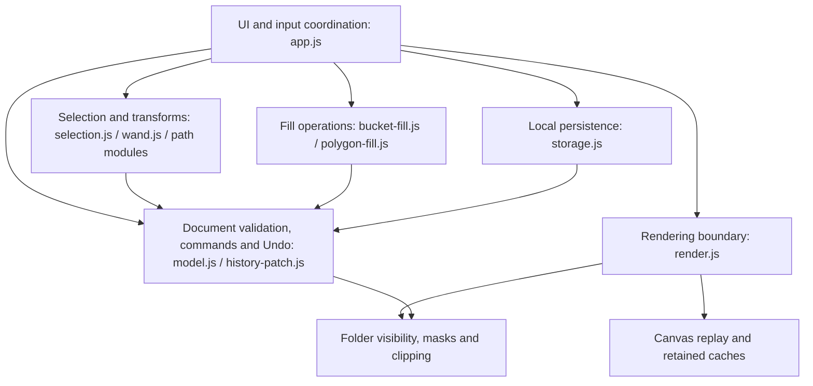

# UNRULY — code structure and change boundaries
Verified against application source at 8a4a94225d01a19716915bc5f7d2551e9b414e73, current browser main FILL2; documentation audit 13-Oct-2026.
This is a logical module map derived from actual source/import reads, not an AST call graph or proof of runtime independence. Update after any build changing module responsibilities, dependencies or document/render contracts.

## Current logical blocks

Arrows mean principal imports/calls across logical blocks; omitted utility imports are not evidence of isolation. This is browser-native module code, not separate services.

| Responsibility | Actual files under prototypes/browser-workspace | Boundary / regression obligation |
| --- | --- | --- |
| UI/input orchestration | app.js, index.html, style.css; gestures.js, pen-input.js, pressure-ui.js, path-selection-ui.js | Events, draft state, tool arbitration and orchestration; UI remains a shared dependency. Add targeted interaction tests plus cumulative journeys. |
| Document authority / history | model.js, history-patch.js | Validation, capacity, commands, version/import remapping, exact Undo/Redo. Model imports feature validators/mutators; feature modules sometimes import model commands, so strict acyclic layering is NOT established. |
| Selection / geometry | selection.js, wand.js, lasso-region.js, path-selection.js, magnetic-selection.js, shapes.js | Distinguish editable artwork versus selection-outline geometry. Pixel edits preserve original artwork through one undoable conversion; no silent whole-object fallback. |
| Fill | bucket-fill.js, polygon-fill.js | Gap traversal and geometric fill reuse bounded raster/selection operations; do not change selection or renderer semantics to obtain green tests. |
| Brush / raster work | brushes.js, brush-recipe.js, raster.js, raster-tiles.js, pixel-paint.js, pixel-surface.js, smudge.js | Pressure/tip replay and bounded pixels; presets and native pixels are distinct. Preserve deterministic replay and codec/capacity contracts. |
| Composition | folders.js, masks.js, clipping.js | Pass-through folder visibility/locks, leaf masks, clip sources and alpha lock. Folder-wide isolation/effects are not implemented and require explicit design. |
| Renderer boundary | render.js, render-contract.js | Chooses replay/reference behavior, composition/cache hooks and diagnostics. No document-storage writes here. |
| Renderer implementation/cache | canvas2d-renderer.js, layer-compositor.js, raster-cache.js | Original replay oracle, retained live rendering, backing/cache budgets and invalidation. Changed pixels require reference comparisons. |
| Text/import | text.js, image-import.js, image-clipboard.js | Input limits, text/raster representation, reference separation and clipboard portability. |
| Persistence/offline delivery | storage.js, sw.js | storage validates through model; revision/conflict/save guards. sw asset list/cache revision must include every new runtime module. Offline smoke required. |

## Honest current limitations
- app.js is 370 physical lines with dense event/UI/operation wiring: a shared coordinator, not a cleanly separated controller per feature.
- model.js centralizes validators/commands and imports feature modules. This map does not prove absence of cycles or low coupling.
- Per-change impact.yaml and plan.yaml have allowed/prohibited paths and regression links, e.g. FILL2. The inspected cumulative workflow runs regression/source hashes; it does NOT consume/enforce those path lists.
- CI successes demonstrate tested scenarios, not perfect scope, clean architecture, target-device performance or independent human approval.
- No unsolicited broad refactor is authorized by this document. A restructuring must have its own bounded scope, behavior-preserving tests and explicit rationale.

## Evidence required for each future code change
1. Pin base/source commit and roadmap row/requirement; list acceptance criteria and exclusions.
2. Trace affected modules and direct callers/importers; record effects on saved format, history, composition, cache/offline assets. Distinguish observed dependencies from guesses.
3. Commit a bounded impact and plan with exact allowed files, prohibited areas and linked tests BEFORE implementing.
4. Review actual diff against that list. Report any unplanned file and revise scope before proceeding. Do not describe this manual check as CI enforcement.
5. Preserve old assertions. Execute targeted positive/negative/cancel/Undo/persistence tests and cumulative QA; renderer changes also compare reference output and budgets.
6. Publish only the verified source; report source commit, CI result, merge/deployment identity and hosted-source comparison.
7. Update PRODUCT_ROADMAP, CURRENT_CHECKPOINT and CONTINUATION_CONTRACT with status/evidence. Update this map only if dependencies/contracts changed. Keep pending scope intact.

## Next authorized colour-adjustment build — proposed localization
Expected new colour/effect module plus UI wiring, document validation/history and composition hooks/tests. Group HSL/levels semantics cannot be assumed to equal applying a filter to each child: settle pass-through versus isolated result, mask/clip/effect ordering, preview lifetime, alpha preservation, saved format and buffers before changing code. Exact allowed files must follow that analysis. No implementation or group architecture is claimed by this map.

## Durable references
- PRODUCT_ROADMAP.md: full scope, not merely next painting builds.
- CURRENT_CHECKPOINT.md and CONTINUATION_CONTRACT.md: latest build identity and constraints.
- .delivery/CHG-UNRULY-FILL2-1013/impact.yaml and plan.yaml: example scoped change.
- .github/workflows/browser-workspace.yml: actual cumulative QA.
- tests/browser-workspace/: model/browser/reference/capacity regressions.
